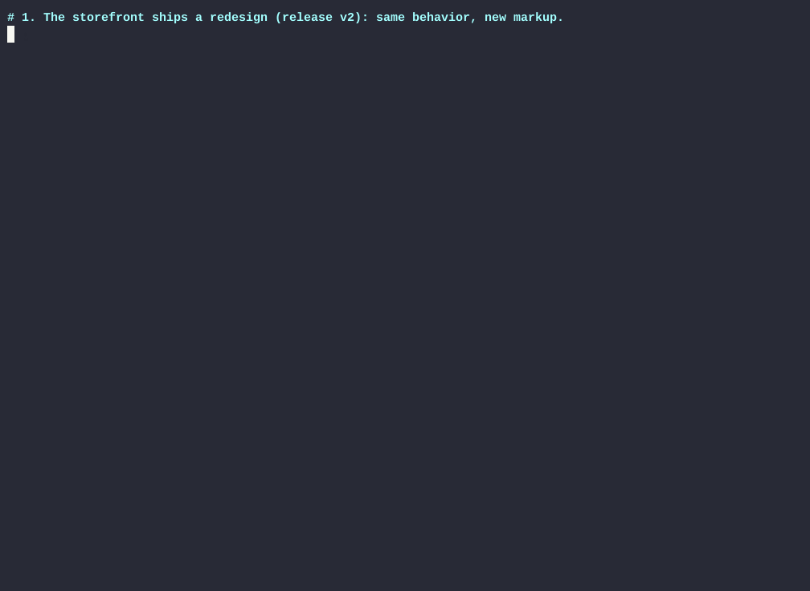

# test_phoenix

[](https://github.com/timlumnah/test_phoenix/actions/workflows/ci.yml)

Self-healing end-to-end tests for web apps you did not write.

An agent explores a web app, drafts a Playwright test suite, and runs it in CI. When a selector breaks, the agent patches the test, re-runs to prove the fix, and writes a pull-request bundle (diff, DOM evidence, re-run logs, a ready `gh pr create` command). A human reviews it and opens the PR. Passing tests are never touched, and a patch that would weaken an assertion is refused by code, not by a polite prompt.



The recording above is a real run, no key and no network: a storefront redesign breaks 2 of 8 tests, phoenix classifies five failures (three are rot or copy changes, two are real bugs), patches only the three, verifies three consecutive green runs, and writes a bundle for a human to merge. Nothing is applied to the working tree. Re-record with `docs/record_demo.sh`.

## What it shows

- **It will not paper over bugs.** Two planted regressions (a wrong price, a removed badge) are refused with the reason printed, and no patch is emitted for either.
- **Patches are guarded in code.** An AST check allows locator-string edits only. Assertion edits, navigation retargets, skip/xfail additions, and injected code are rejected before review.
- **A fix must prove itself.** A patch counts only after three consecutive green runs of the full suite in a sandbox.
- **It drafts tests from a bare URL.** The explorer and drafter produce a suite where every claim traces to something observed. The same pipeline ran against a third-party public practice app and came back 3x green.
- **Honest failure history.** Early model drafts were rejected 12 of 12 by the no-invented-facts gate, and two of those rejections were the harness lying, not the model. That story and the full version record are in [docs/HISTORY.md](docs/HISTORY.md).

Status: v0.1 through v0.5 are built. As of 2026-11-22 the local suite passes (77 passed, 1 skipped opt-in model test). Nothing is published or applied automatically: merge is a human command.

## Try it

```
python3 -m venv .venv && .venv/bin/pip install -r requirements-dev.txt
.venv/bin/python -m playwright install chromium
.venv/bin/python -m pytest -q                    # suite + all evals, 77 passed, 1 skipped (opt-in model test)
RELEASE=v2 .venv/bin/python -m pytest tests -q   # redesign ships: 2 failed, 6 passed
.venv/bin/python -m phoenix.capture              # labeled failures + classifier report
.venv/bin/python -m phoenix.patcher              # self-heal loop: patch, verify, bundle
.venv/bin/python -m phoenix.draft_cli --release v1            # cold-start: explore + rule draft + verify
.venv/bin/python -m phoenix.draft_cli --url https://the-internet.herokuapp.com   # v0.5 breadth: same loop, third-party live site
.venv/bin/python -m phoenix.draft_cli --model openrouter:<model>  # optional: add the model path (needs key; funded and :free OpenRouter routes both answer)
```

## Why this exists

Born from maintaining a Selenium-backed automation platform with hundreds of live selectors against real listing sites. After launch, the number one cost of browser automation is selector rot. Apps change under you daily and suites die by attrition. The standard answer is "write better locators." That only postpones the same failure. test_phoenix automates the maintenance loop itself and gates every automatic patch with verification and human review.

## The loop

```
explore -> draft -> run -> classify -> patch -> verify -> PR
```

1. **Explore:** walk the app via the accessibility tree (ARIA snapshots), not pixels. Enumerate pages, interactive elements, and user flows. Record structure.
2. **Draft:** propose one pytest-playwright test per flow, preferring stable locators (role + accessible name over CSS/XPath chains). A human reviews and merges the first suite. From then on the suite maintains itself.
3. **Run:** headless in CI (GitHub Actions).
4. **Classify the failure:** selector rot vs. app regression vs. flaky wait. This is the hard part and the entire point. A bot that misclassifies a regression as rot will "fix" the test until a real bug reads green.
5. **Patch:** locators and wait handling may change. Assertions and test intent may not. A patch that weakens or deletes an assertion is rejected by a diff checker before review, not by a suggestion.
6. **Verify:** a patch counts only when the previously red test passes three consecutive runs and the rest of the suite stays green.
7. **PR bundle:** the pipeline writes the failure evidence, the DOM it patched against, the diff, the re-run log, and a ready `gh pr create` command to `prs/<name>/`. A human reads it, applies it, and opens the PR. Nothing is applied or published automatically.

## Guardrails

- Patch scope is enforced at the AST level (locator and wait nodes only), not by asking the model politely.
- The agent can never delete or skip a test. Xfail and skip are human-only verbs.
- Every action is logged: input snapshot, patch proposal, re-run results.
- Model output is treated as untrusted input: strict JSON replies, schema-reject on violation.

## Failure modes the evals must catch

- The app genuinely redesigned the flow. The locator patch is right but the test's intent now describes a dead workflow. Eval scenario plants this; expected output is a flagged PR, not a silent green.
- The bot papers over a real regression by loosening a wait. Guard: assertions are read-only. Eval scenario plants this.
- Flaky network wait vs. missing selector. The classifier must separate them. Labeled fixtures ship in the repo.

## Demo target

`demo_app/` ships in this repo: a small FastAPI + HTML storefront whose releases deliberately churn class names, accessible names, and DOM order. That gives the project its proof artifact and its demo. One release renames a button, the suite goes red, and the patcher writes a verified patch bundle, all on screen in under two minutes (see the recording above).

## Stack

- Python 3.12+
- Playwright for Python, pytest-playwright
- FastAPI (demo app)
- GitHub Actions
- Bring-your-own model interface: any OpenAI-compatible API (OpenAI, OpenRouter) or a local model via Ollama, same pattern as open_otto. The rule drafter and CI harness need no account, no key, no hosted service; the model path is opt-in. OpenRouter is the live-verified backend (free route 2026-11-20, paid route 2026-11-21); `:free` routes work even on an unfunded account.
- pytest

## Status and open work

v0.1 through v0.5 are built and verified locally (version-by-version record and measurements: [docs/HISTORY.md](docs/HISTORY.md)). What is not done, stated plainly:

- **Self-heal is demonstrated on one app.** Classify and patch need releases that churn on demand, which only the bundled `demo_app` provides. The breadth proof against a third-party site covers cold-start drafting and verification, not self-healing.
- **No PR is opened automatically.** The pipeline writes the bundle and the `gh pr create` command; a human runs it. That is deliberate, and it also means the PR-opening step is untested.
- **Model drafting is opt-in and less reliable than the rule drafter.** In the funded run, 10 of 11 drafted tests passed the first execution; the one miss was caught by the 3x run gate, not the checker.
- **One public target.** The live-site proof is a single practice app, run twice.

## Non-goals

- Visual / screenshot-diff testing
- Replacing codegen or a test recorder
- Writing business assertions without human review
- Bulk site automation or scraping anything that forbids it
- Team features, permissions, a hosted version

## License

AGPL-3.0, see `LICENSE`. Free to use, modify, and self-host. Anyone who runs a modified version as a service publishes their changes.
